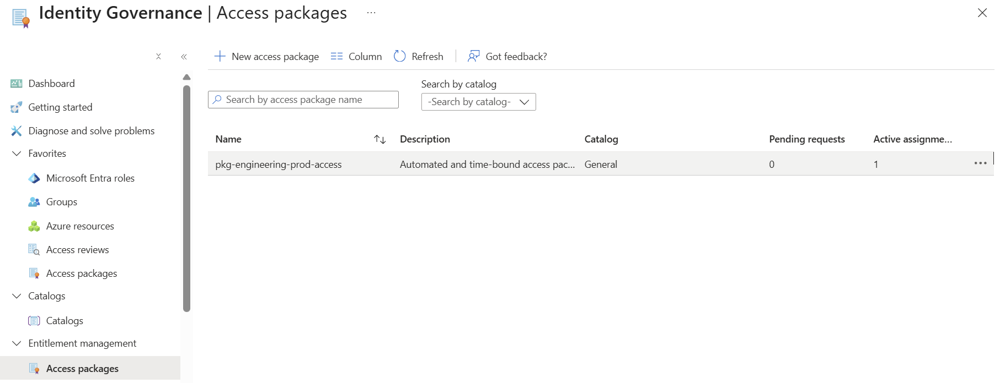
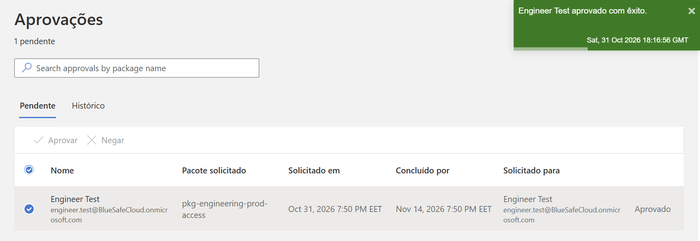
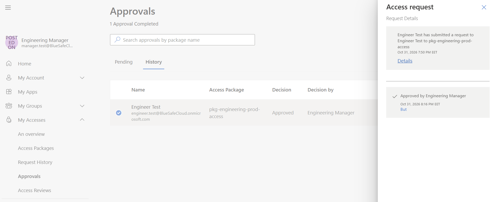
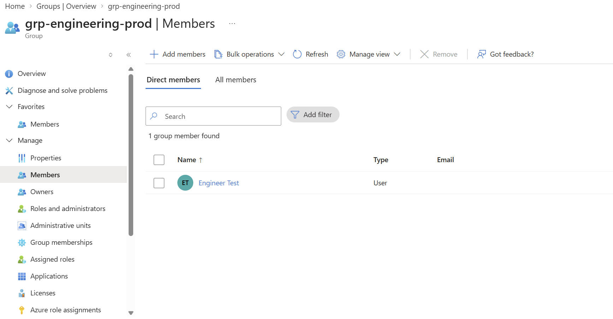

# Azure Entra ID - Automated Access Lifecycle Management

## 📌 Project Overview
This project demonstrates the implementation of **Identity Governance and Access Lifecycle Management** using Microsoft Entra ID. Instead of manually managing group memberships, this architecture leverages **Entitlement Management** to build a self-service, time-bound access package for internal engineering resources. This solution enforces the **Least Privilege Principle** and completely eliminates the risk of **Permission Creep**.

## 🏗️ Architecture & Workflow Design
The system automates the access lifecycle through a 4-step sequence:
1. **Request Phase (Self-Service):** An active user (`engineer.test`) requests access to a production container via the specialized end-user portal (`://microsoft.com`).
2. **Evaluation Phase (Dual Authorization):** To isolate administrative boundaries, a non-privileged business manager (`manager.test`) reviews the request, checks the business justification, and authorizes it.
3. **Provisioning Phase (Automated):** Upon approval, the Microsoft Entra engine automatically injects the user into the target security group (`grp-engineering-prod`).
4. **Lifecycle Expiration (Auto-Remediation):** The access profile strictly expires after **30 days**, automatically purging the identity from the target resource without manual IT intervention.

## 🛠️ Configuration Blueprint

### 1. Target Resource Container
* **Group Name:** `grp-engineering-prod`
* **Group Type:** Security Group
* **Membership:** Assigned (Driven exclusively by the Access Package engine)

### 2. Access Package Policy (`pkg-engineering-prod-access`)
* **Resource Assignment:** `grp-engineering-prod` (Role: Member)
* **Request Scope:** `For users in your directory` -> `All members (excluding guests)`
* **Self-Service:** Enabled (`Self` capability unlocked via Entra ID P2 tenant capabilities)
* **Approval Process:** 1-Stage manual approval required.
  * **Designated Approver:** `manager.test` (Engineering Manager)
  * **SLA Timeout:** 14 days (Automatic rejection if no action is taken)
  * **Justification:** Mandatory for both Requestor and Approver.
* **Lifecycle Duration:** Explicitly hardcoded to **30 days** fixed retention.

## 🧪 Validation & Troubleshooting Insights
During the deployment phase, two major configuration hurdles were encountered and resolved using structured troubleshooting logic:
* **Issue 1 (Access Package Visibility):** The requestor initially received a "You don't have permission" error. 
  * *Resolution:* The configuration was inspected, and the policy request settings were updated to explicitly enable the **Self** request toggle, allowing users to safely self-initiate workflows.
* **Issue 2 (Identity Scope Alignment):** Handled directory scope boundaries by separating human identities from automated system scopes (**Microsoft Agent 365 / Agent Scope**), ensuring proper directory assignment for internal staff.

## 🎯 Key Technical Takeaways
* **Separation of Duties:** Proved that line-of-business managers do not require administrative directory roles (such as Global Admin) to oversee resource entitlements.
* **Tenant-Level Licensing Logic:** Utilized a single Entra ID P2 license seat to enable and test tenant-wide architecture engines for scale testing.
* **Zero Standing Access:** Successfully implemented an identity lifecycle that clears itself, aligning with core **Zero Trust** concepts.

## 📊 Proof of Concept (Visual Evidence)

### 1. Access Package Configuration Console
Successfully provisioned the target governance container inside the Entra ID catalog architecture, showing 1 active assignment.

### 2. Live Approval Action Notification
The portal immediately triggers a green success notification banner ("Engineer Test aprovado com êxito") right when the approval payload executes.

### 3. Manager Approval History (MyAccess Portal)
The business manager workflow logs show that the request from `engineer.test` was validated and approved by the non-privileged `Engineering Manager`.

### 4. Automated Target Group Assignment Result
The directory engine automatically added the user `Engineer Test` as a direct member of the isolated infrastructure security container.

